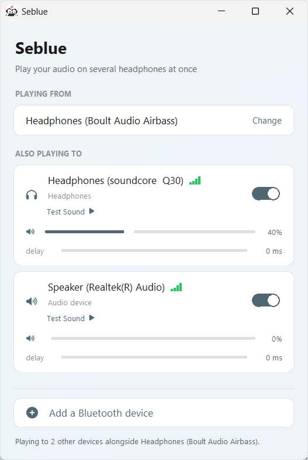
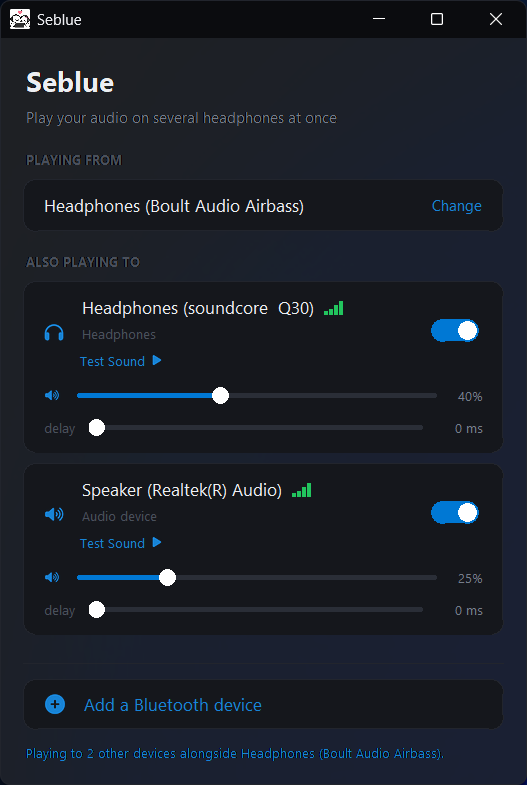

# Seblue Connect
<p align="center">
  
</p>

Seblue routes audio from the current Windows output to other connected audio
devices at the same time. Use it to let several people listen through separate
headphones or speakers.


| Windows Flow | Windows Dark |
| :---: | :---: |
|  |  |


## Run Seblue

Download **`Seblue-Setup.exe`** from the [latest GitHub release](https://github.com/MeatRollBoomin/SeBlue/releases/latest) and run it. It sets up Seblue for the current Windows user. During setup, you can choose whether to create a desktop shortcut and launch Seblue when you sign in. Both options are enabled by default; sign-in launch starts the app in the system tray.

## Using the app

1. **Playing from** shows the output Windows is using as the audio source.
   Select **Change** to choose another source.
2. Under **Also playing to**, turn on each device that should receive the audio.
3. Set each device’s volume and mute state independently. Use **Test Sound** to
   check an output.
4. Adjust a device’s delay slider to bring it into sync with the source.

Seblue scans for output devices while it is open. A selected device remains
remembered while disconnected and starts receiving audio again when it returns.
Use **Retry** on a device row if its output fails to open.

The four-bar indicator reports playback stability from recent audio underruns.
It does not report Bluetooth radio signal strength.


Minimize or close the window to hide Seblue in the notification area. Choose
**Open Seblue** from its tray menu to show the window again, or choose **Exit**
to stop routing and close the app.

### Keyboard controls

- **Tab** / **Shift+Tab** moves focus between controls.
- **Space** or **Enter** activates the focused button or switch.
- On a focused slider, **Left/Right** adjusts in small steps;
  **Page Up/Page Down** adjusts in larger steps; **Home/End** selects minimum
  or maximum.

## Audio and timing

Seblue captures the current output using WASAPI loopback and sends it to each
selected endpoint. Each endpoint has its own playback stream and volume control.
Seblue aligns streams using the output latency reported by Windows and provides
a per-device delay adjustment for additional tuning.

Bluetooth codec latency occurs after Windows’ reported output latency, so the
app cannot measure that part automatically. To sync listeners, play a steady
beat and increase the delay on whichever device sounds early. The delay setting
is saved for that device.

The source device plays directly from Windows and will generally be ahead of
the routed devices. For the closest timing match, choose a source that nobody
is listening to and route all listening devices through Seblue.

Bluetooth adapter limits still apply. Some adapters cannot maintain multiple
Bluetooth audio connections at once; Seblue can route to endpoints that Windows
has connected.

## Build from source

Install Python and the project dependencies, then launch the app:

```powershell
pip install -r requirements.txt
python Seblue.pyw
```

The launcher checks for missing dependencies and installs them for the current
user. To build the standalone executable:

```powershell
pip install pyinstaller
python -m PyInstaller --noconfirm --clean Seblue.spec
```

PyInstaller writes `dist/Seblue.exe` and its work files to `build/`.

The GitHub release download is `Seblue-Setup.exe`.

## Libraries

- **NumPy** handles audio sample buffers and signal processing.
- **PyAudioWPatch** and **PortAudio** capture Windows output and play to other
  audio endpoints.
- **PyCAW** and **comtypes** access Windows Core Audio devices and controls.
- **miniaudio** decodes the bundled MP3 test sound.
- **pystray** and **Pillow** provide the notification-area icon.
- **tkinter-icons** supplies the Font Awesome device and control icons.
- **Tkinter** provides the desktop interface; it is included with standard
  Windows Python distributions.

## Source map

| Path | Purpose |
| --- | --- |
| `seblue/app.py` | Window, controls, device scanning, tray behavior |
| `seblue/engine.py` | Audio capture, buffering, timing, and output streams |
| `seblue/endpoints.py` | Windows audio endpoint discovery and controls |

## Troubleshooting

- **No sound from a selected output:** check its Seblue volume and Windows
  output volume. If it reports an error, reconnect the device and use **Retry**.
- **Audio stutters:** move closer to the Bluetooth adapter or reduce the number
  of active Bluetooth streams.
- **Devices sound out of sync:** increase the delay on the device that sounds
  early.
- **Second headset will not connect:** check whether the Bluetooth adapter and
  Windows can connect to both headsets simultaneously.

## License

 Forked from [Multi-Blu](https://github.com/shreyasmandem/multi-blu). Seblue is distributed under the MIT License; see [LICENSE](LICENSE). The
device icons use Font Awesome Free under [CC BY 4.0](https://creativecommons.org/licenses/by/4.0/).
